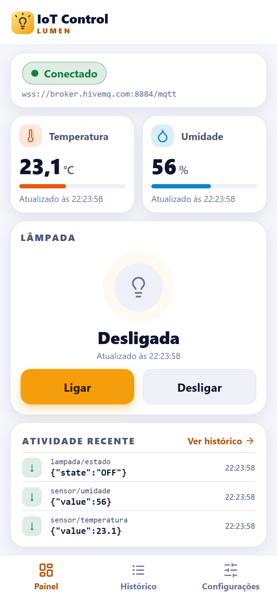
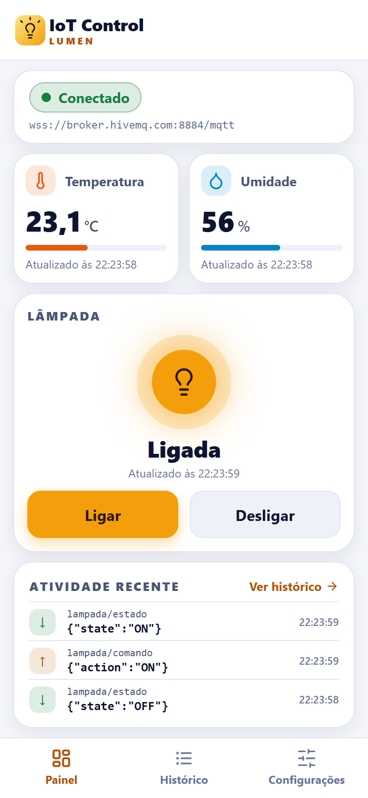
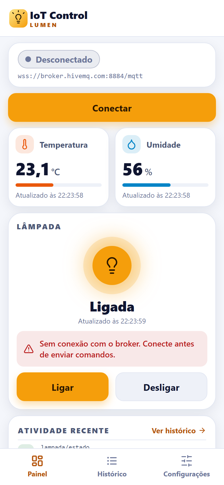
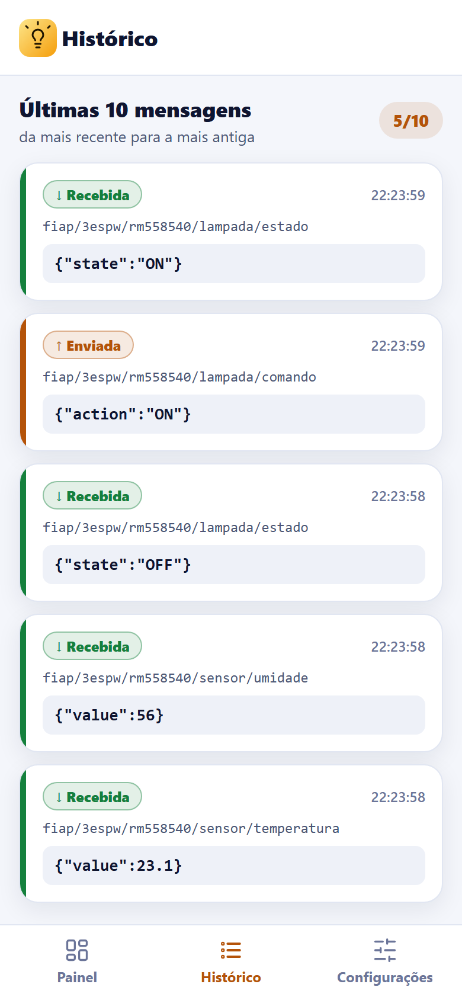
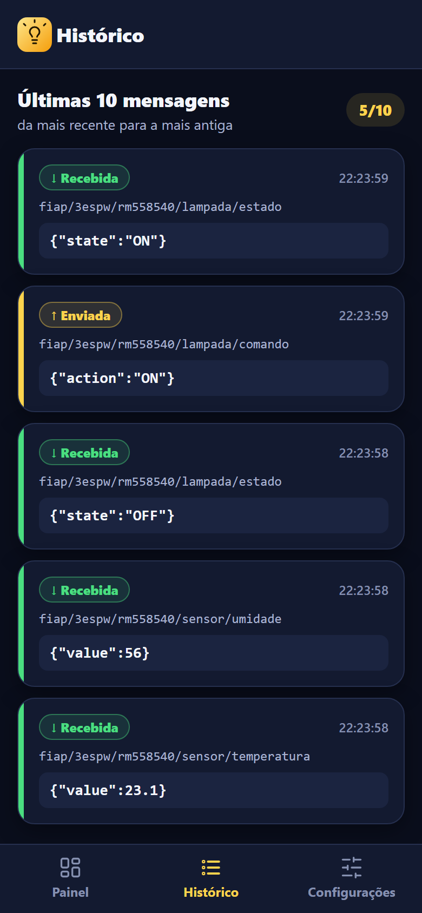
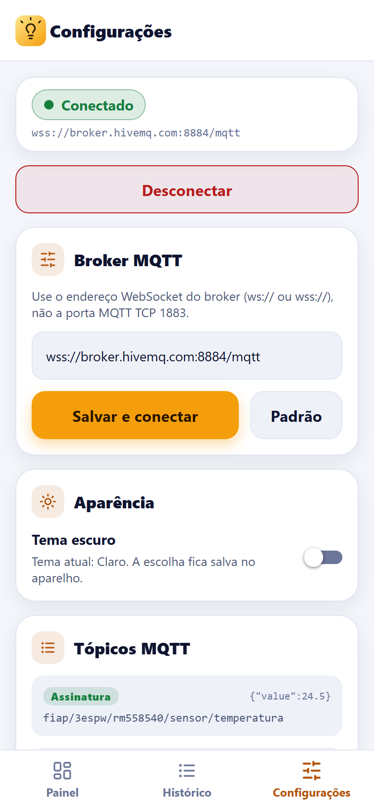
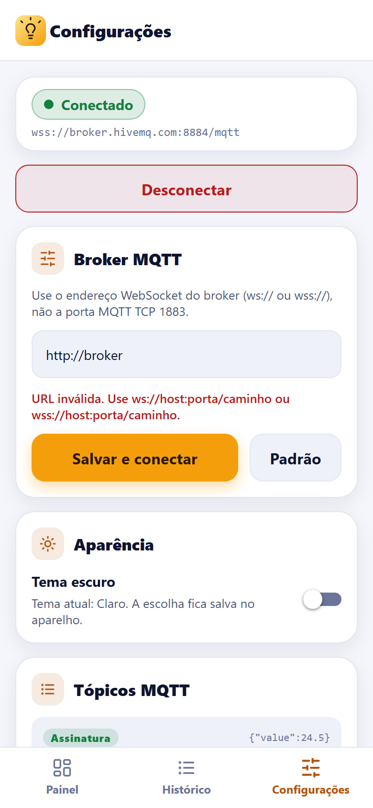
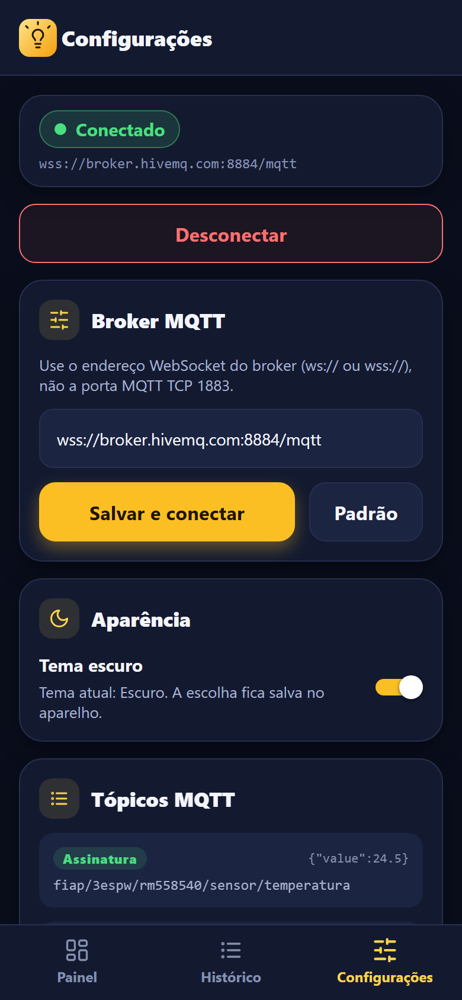
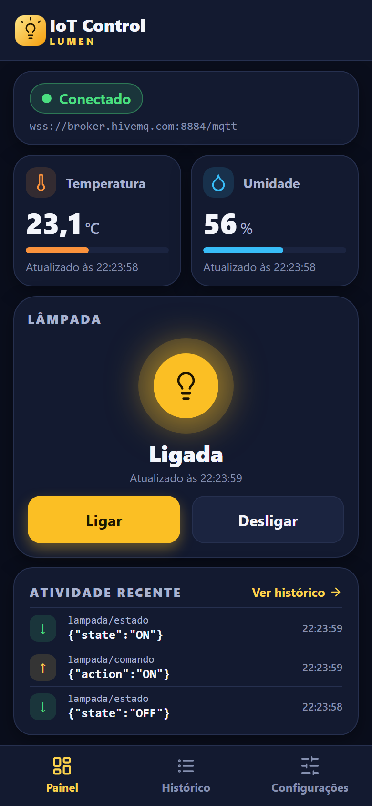
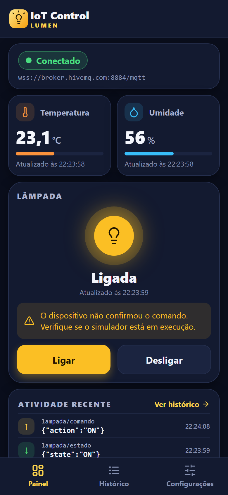

# IoT Control — Painel de Monitoramento e Controle IoT via MQTT

Checkpoint 3 — Mobile Development & IoT · FIAP · Turma **3ESPW**

## Identificação

| Nome completo | RM |
|---|---|
| **Renan Dias Utida** | **558540** |

Grupo: **Lumen** (trabalho individual).

---

## Descrição e objetivo

**IoT Control** é um aplicativo mobile feito com **React Native, Expo e TypeScript** que acompanha e controla um ambiente inteligente simulado por meio do protocolo **MQTT** (modelo *publish/subscribe*):

- exibe, em tempo real, a **temperatura** e a **umidade** publicadas por um dispositivo;
- mostra o **estado de uma lâmpada virtual** e permite **ligá-la e desligá-la** publicando comandos;
- guarda o **histórico das 10 últimas mensagens** (enviadas e recebidas);
- salva a **URL do broker** e o **tema (Light/Dark)** com AsyncStorage.

Não é preciso hardware: o repositório inclui um **simulador do dispositivo** (`simulator/simulator.mjs`) que publica as leituras e responde aos comandos da lâmpada.

## Funcionalidades

- **Conexão MQTT:** URL WebSocket configurável, conectar/desconectar, estados *conectando*, *conectado*, *desconectado* e *erro*, mensagens de falha e reconexão (automática se a conexão cair durante o uso; botão **Tentar novamente** se a primeira conexão falhar).
- **Recebimento em tempo real:** inscrição nos tópicos de temperatura, umidade e estado da lâmpada, com o último valor e o horário da atualização. Nada de botão de atualizar.
- **Validação das mensagens:** payloads com JSON inválido, tipo errado ou valores fora do intervalo são ignorados (o app avisa e não quebra).
- **Comandos:** botões **Ligar** e **Desligar**. Sem conexão, o app **não publica em silêncio**: mostra um aviso. A lâmpada na tela só muda quando chega a **mensagem de estado** enviada pelo dispositivo, não ao tocar no botão. Se o dispositivo não confirmar em 8 segundos, o app avisa.
- **Histórico:** as 10 mensagens mais recentes (tópico, conteúdo, horário e direção *enviada*/*recebida*), atualizadas ao vivo.
- **Preferências:** URL do broker e tema salvos com **AsyncStorage** e recuperados ao reiniciar o app. Temas **Light e Dark** em todas as telas.
- **Identidade visual:** marca **Lumen** (logo no cabeçalho e na tela de carregamento), paleta âmbar e azul-marinho nos dois temas, ícones vetoriais, medidores nos sensores e um resumo de **Atividade recente** no Painel.

## Tecnologias e versões

| Tecnologia | Versão |
|---|---|
| Node.js | 24.22.1 (mínimo exigido pelo Expo SDK 58: 22.13) |
| npm | 11.19.1 |
| Expo SDK | `expo` 58.0.20 |
| React Native | 0.88.0 |
| React | 19.3.0 |
| TypeScript | 6.0.3 |
| mqtt (MQTT.js) | 5.16.1 |
| React Navigation | `@react-navigation/native` 7.5.1 · `@react-navigation/bottom-tabs` 7.21.0 |
| AsyncStorage | `@react-native-async-storage/async-storage` 2.2.0 |
| Outros | `react-native-screens` 4.30.0 · `react-native-safe-area-context` 5.10.1 · `react-native-svg` 15.16.0 (logo e ícones) · `react-native-web` 0.21.4 · `expo-status-bar` 58.0.4 |

## Estrutura do projeto

```text
App.tsx                         # providers (tema, MQTT) + navegação
simulator/
  simulator.mjs                 # simulador do dispositivo IoT (Node)
src/
  components/
    AppButton.tsx               # botão reutilizável
    BrandSplash.tsx             # tela de carregamento com a marca
    BrandTitle.tsx              # título "IoT Control · LUMEN" do cabeçalho
    ConnectionStatus.tsx        # status da conexão
    Icon.tsx                    # ícones vetoriais (SVG) que seguem o tema
    LampCard.tsx                # cartão da lâmpada + Ligar/Desligar
    LumenLogo.tsx               # logo da Lumen (SVG)
    MessageItem.tsx             # item do histórico
    RecentActivity.tsx          # últimas mensagens no Painel
    SensorCard.tsx              # cartão de temperatura/umidade com medidor
  config/mqttConfig.ts          # tópicos, URL padrão e limite do histórico
  context/MqttContext.tsx       # estado do app: conexão, sensores, lâmpada, histórico
  navigation/AppNavigator.tsx   # abas Painel · Histórico · Configurações
  screens/
    DashboardScreen.tsx
    HistoryScreen.tsx
    SettingsScreen.tsx
  services/
    mqttService.ts              # toda a comunicação MQTT (separada da interface)
    messageParser.ts            # validação dos payloads
    telemetry.ts                # regras de atualização do estado e do histórico
    storageService.ts           # AsyncStorage
  themes/                       # cores Light/Dark e ThemeContext
  types/mqtt.ts                 # tipos
  utils/
    color.ts                    # cores translúcidas (rgba)
    format.ts                   # formatação de hora e número
docs/prints/                    # prints das telas
```

## Instalação e execução

### Pré-requisitos

- **Node.js 22.13 ou superior** (testado com a 24.22.1) e npm.
- Git.
- Para rodar no celular: o app **Expo Go** (Android ou iOS) compatível com o **SDK 58**.

### Passo a passo

```bash
# 1. baixar o projeto e instalar as dependências
git clone https://github.com/renan-utida/iot-control-mqtt.git
cd iot-control-mqtt
npm install

# 2. Terminal 1: iniciar o simulador do dispositivo (deixe aberto)
npm run simulate

# 3. Terminal 2: iniciar o app
npm start
```

Com o `npm start` em execução:

- **Celular (Android/iOS):** abra o **Expo Go** e escaneie o QR code do terminal (celular e computador na **mesma rede Wi-Fi**).
- **Navegador (Web):** pressione a tecla **`w`** no terminal do Expo, ou rode `npm run web`. O app abre em `http://localhost:8081`. Para ver em formato de celular, use as ferramentas do navegador (F12 → modo dispositivo).

> **Se o Expo Go não conseguir abrir o app:** redes de faculdade/empresa costumam bloquear a comunicação entre dispositivos. Use o **ponto de acesso (hotspot) do celular** conectando o computador a ele, ou rode `npx expo start --tunnel`. Em último caso, use a versão Web.

### Scripts disponíveis

| Comando | O que faz |
|---|---|
| `npm start` | inicia o servidor do Expo (QR code) |
| `npm run web` | inicia o Expo direto no navegador |
| `npm run android` / `npm run ios` | inicia o Expo abrindo no emulador (se houver) |
| `npm run simulate` | executa o simulador do dispositivo |
| `npm run typecheck` | verifica os tipos com o TypeScript |
| `npm run lint` | executa o ESLint |

## Broker MQTT

O app usa o broker público da **HiveMQ** por **WebSocket seguro**:

| | |
|---|---|
| **URL padrão** | `wss://broker.hivemq.com:8884/mqtt` |
| Alternativa (sem TLS) | `ws://broker.hivemq.com:8000/mqtt` |

> **Atenção:** a porta **1883** (e a 8883) é a porta MQTT **TCP** e **não funciona** no app, que precisa de **WebSocket**. O app recusa essas portas e explica o motivo.

Para trocar de broker, abra a aba **Configurações**, digite a URL (`ws://` ou `wss://`) e toque em **Salvar e conectar**. A URL fica salva no aparelho. O botão **Padrão** restaura a URL acima. **Nenhuma senha, token ou credencial** é usada ou guardada no repositório.

## Tópicos MQTT

Todos os tópicos usam o identificador exclusivo do grupo `fiap/3espw/rm558540` para não interferir com outros projetos no broker público.

| Tópico | Direção no app | Payload de exemplo | QoS |
|---|---|---|---|
| `fiap/3espw/rm558540/sensor/temperatura` | **Subscribe** | `{"value":24.5}` | 1 |
| `fiap/3espw/rm558540/sensor/umidade` | **Subscribe** | `{"value":58}` | 1 |
| `fiap/3espw/rm558540/lampada/estado` | **Subscribe** | `{"state":"ON"}` ou `{"state":"OFF"}` | 1 |
| `fiap/3espw/rm558540/lampada/comando` | **Publish** | `{"action":"ON"}` ou `{"action":"OFF"}` | 1 |

**Validação aplicada às mensagens recebidas:**

- temperatura: número entre **-50 e 100** (°C); umidade: número entre **0 e 100** (%);
- estado: `ON` ou `OFF` (aceita minúsculas);
- além do JSON, também é aceito o valor puro (`24.5`, `ON`), útil em testes manuais;
- qualquer outra coisa é descartada: o valor anterior é mantido e a tela mostra o aviso *Mensagem inválida ignorada*.

## Simulador do dispositivo

O simulador é um script Node (`simulator/simulator.mjs`) que usa a própria biblioteca `mqtt` do projeto (nenhuma instalação extra além do `npm install`). Ele faz o papel da lâmpada e dos sensores:

- a cada **5 segundos** publica a **temperatura** (18–32 °C, variação suave), a **umidade** (35–80 %) e o **estado da lâmpada**;
- escuta o tópico `lampada/comando`; ao receber `{"action":"ON"}` ou `OFF`, atualiza a lâmpada e **publica o novo estado** em `lampada/estado`;
- ignora comandos inválidos e avisa no terminal.

```bash
npm run simulate                                   # padrão
npm run simulate -- --interval 2                   # leituras a cada 2 s
npm run simulate -- --url ws://broker.hivemq.com:8000/mqtt
npm run simulate -- --help                         # todas as opções
```

**Comandos que podem ser digitados no terminal do simulador:**

| Comando | Efeito |
|---|---|
| `t 31.5` | publica a temperatura 31,5 |
| `u 70` | publica a umidade 70 |
| `on` / `off` | liga/desliga a lâmpada como um interruptor físico |
| `status` | mostra os valores atuais |
| `q` (ou Ctrl+C) | encerra o simulador |

### Alternativa: simular com outro cliente MQTT

Sem o simulador, use qualquer cliente MQTT com suporte a WebSocket (por exemplo o [HiveMQ WebSocket Client](https://www.hivemq.com/demos/websocket-client/) ou o MQTTX):

1. Conecte em `broker.hivemq.com`, porta **8884**, caminho `/mqtt`, com **TLS** ativado.
2. Assine `fiap/3espw/rm558540/lampada/comando`.
3. Publique `{"value":24.5}` em `.../sensor/temperatura` e `{"value":58}` em `.../sensor/umidade`: os valores aparecem no app.
4. Ao tocar em **Ligar** no app, chega `{"action":"ON"}` no tópico de comando. Publique `{"state":"ON"}` em `.../lampada/estado`: o app passa a mostrar **Ligada**.

## Roteiro para verificar o ciclo completo

Com `npm run simulate` e o app abertos (Expo Go ou Web):

| # | O que fazer | Resultado esperado |
|---|---|---|
| 1 | Abrir o app | Status **Conectado**; a **temperatura** aparece e atualiza a cada 5 s (ou use `t 31.5` no simulador) |
| 2 | Observar a umidade | A **umidade** aparece e atualiza (ou use `u 70`) |
| 3 | Tocar em **Ligar** | O comando `{"action":"ON"}` é publicado e o simulador registra o recebimento no terminal |
| 4 | Aguardar a resposta | O simulador publica `{"state":"ON"}` |
| 5 | Ver o painel | O app mostra a lâmpada **Ligada** (vinda da mensagem de estado) |
| 6 | Tocar em **Desligar** | O mesmo fluxo termina com a lâmpada **Desligada** |
| 7 | Abrir a aba **Histórico** | As mensagens enviadas (↑) e recebidas (↓) aparecem, no máximo 10 |

Testes de erro: feche o simulador (`q`) e toque em **Ligar** → o app avisa que o dispositivo não confirmou; em **Configurações**, toque em **Desconectar** e depois em **Ligar** no painel → o app informa que está sem conexão.

## Telas e prints

Prints do app em execução, com o simulador publicando as leituras e respondendo aos comandos.

### Painel (Dashboard)

Status da conexão, temperatura e umidade (com medidor), estado da lâmpada, botões **Ligar**/**Desligar** e as últimas mensagens em **Atividade recente** (com atalho para o Histórico).

<table>
<tr>
<td align="center"><br><sub>Conectado, lâmpada desligada</sub></td>
<td align="center"><br><sub>Lâmpada ligada (após o estado recebido)</sub></td>
<td align="center"><br><sub>Sem conexão: aviso e botão Conectar</sub></td>
</tr>
</table>

### Histórico

As 10 mensagens mais recentes, com direção, tópico, conteúdo e horário.

<table>
<tr>
<td align="center"><br><sub>Histórico (tema claro)</sub></td>
<td align="center"><br><sub>Histórico (tema escuro)</sub></td>
</tr>
</table>

### Configurações

URL do broker, conectar/desconectar, alternância de tema e lista de tópicos.

<table>
<tr>
<td align="center"><br><sub>Configurações (tema claro)</sub></td>
<td align="center"><br><sub>Validação da URL do broker</sub></td>
<td align="center"><br><sub>Configurações (tema escuro)</sub></td>
</tr>
</table>

### Tema escuro e feedback ao usuário

<table>
<tr>
<td align="center"><br><sub>Painel no tema escuro</sub></td>
<td align="center"><br><sub>Dispositivo não confirmou o comando</sub></td>
</tr>
</table>

## Como funciona

- **`mqttService`** concentra toda a comunicação MQTT e não conhece a interface. Ele expõe `connect`, `disconnect`, `publish` e dois *listeners* (`onStatusChange`, `onMessage`) que devolvem a função de cancelamento. Ao trocar de conexão, os *listeners* do cliente antigo são removidos, o que evita eventos duplicados.
- **`MqttProvider`** (React Context) assina o serviço **uma única vez** com `useEffect` e **cancela tudo ao desmontar**. Mantém conexão, sensores, lâmpada, histórico e o estado do comando (*enviando → aguardando confirmação → confirmado/tempo esgotado*).
- **Reconexão:** se a conexão cair com o app em uso, o cliente tenta de novo a cada 5 s e refaz a inscrição. Se a **primeira** conexão falhar (URL errada, sem internet, tempo esgotado em 15 s), o app para de tentar, mostra o motivo e oferece **Tentar novamente**.
- **Lâmpada:** o estado exibido vem **sempre** da mensagem recebida em `lampada/estado`.
- **Tema:** o `ThemeProvider` lê a preferência salva; sem preferência, segue o tema do sistema.

## Checklist de entrega

- [x] Conecta ao broker via WebSocket
- [x] Mostra status da conexão e erros
- [x] Recebe temperatura e umidade em tempo real
- [x] Publica comandos ON/OFF
- [x] Recebe confirmação de estado da lâmpada
- [x] Exibe o histórico das 10 últimas mensagens
- [x] Salva URL do broker e tema com AsyncStorage
- [x] Possui Light/Dark
- [x] Usa TypeScript, hooks e componentes organizados
- [x] Não acumula listeners duplicados
- [x] Inclui simulador e procedimento de simulação reproduzível
- [x] README documenta tópicos, execução, nome e RM
- [x] Repositório GitHub acessível

## Limitações e observações

- **Onde foi validado:** o ciclo completo (conexão, sensores, Ligar/Desligar, histórico, URL e tema salvos, erros) foi executado e verificado no **celular (Android, pelo Expo Go)** e no **navegador (Web)**, sempre com o simulador. O **bundle iOS compila** pelo Expo, mas não foi executado em um aparelho iOS.
- **Broker público:** o broker da HiveMQ é aberto e sem autenticação, então qualquer cliente que assine os mesmos tópicos vê as mensagens. O prefixo `fiap/3espw/rm558540` evita misturar com outros projetos. Ele também pode demorar para aceitar a conexão; nesse caso o app mostra *Tempo esgotado ao conectar ao broker* e o botão **Tentar novamente**.
- **Web:** o `Alert` do React Native não existe no navegador, por isso os erros de envio também aparecem em **texto dentro do cartão da lâmpada** (funciona em todas as plataformas).
- **Histórico em memória:** as 10 mensagens ficam apenas enquanto o app está aberto (apenas a URL do broker e o tema são salvos).
- **Rede:** o computador e o celular precisam estar na mesma rede para o Expo Go; veja as alternativas (hotspot, `--tunnel`) em [Instalação e execução](#instalação-e-execução).
- **Ícones e logo:** são desenhados em SVG (`react-native-svg`, já incluído no Expo Go), sem imagens externas, e acompanham o tema Light/Dark.
